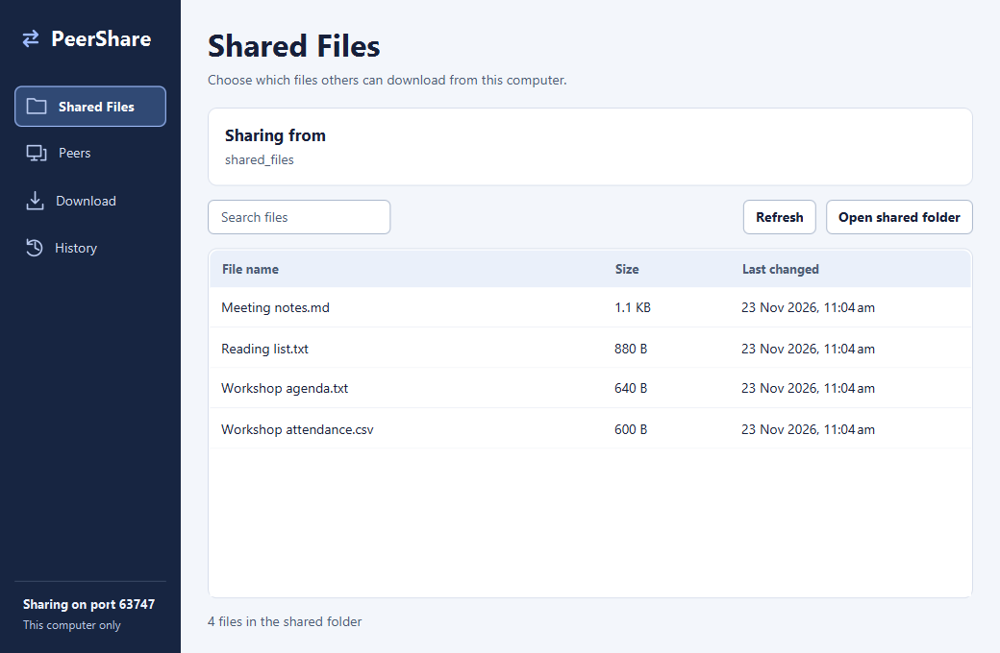
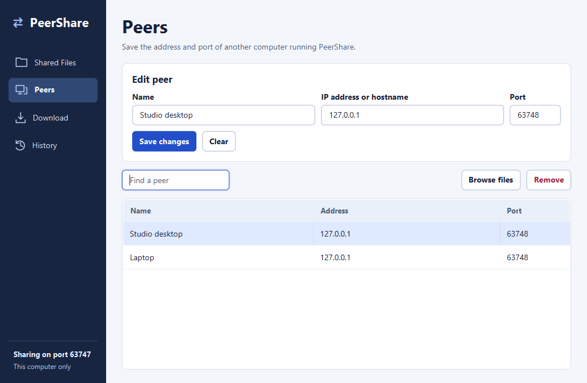
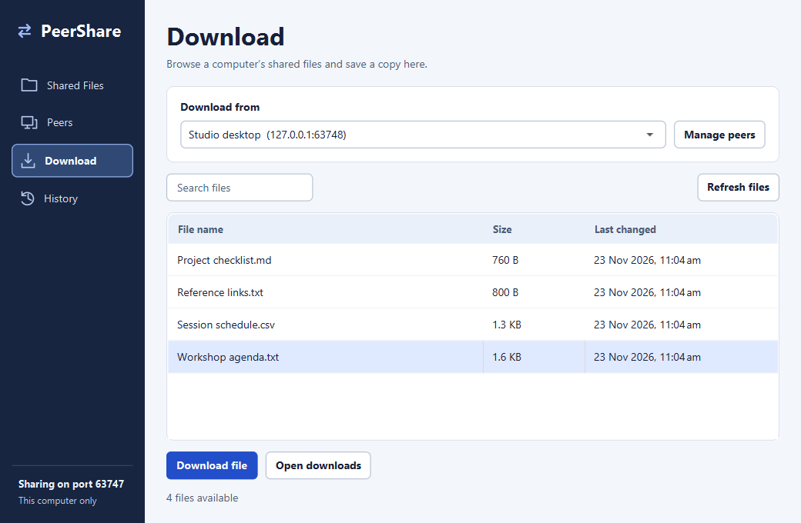
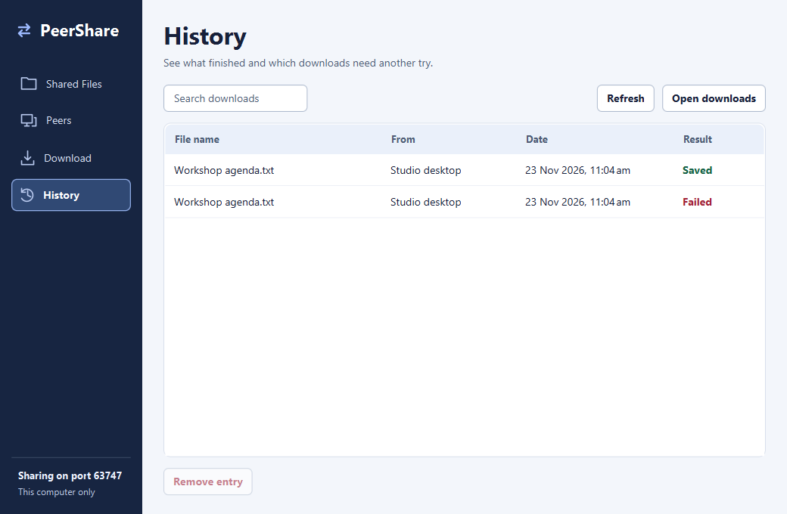

# PeerShare

PeerShare sends files between two open copies of the app. You can try it with two copies on one computer, or use it between computers on the same Wi‑Fi or wired network. No account or internet connection is needed.



## Open PeerShare

See the [new-laptop setup checklist](requirement.txt) for everything you need to get started.

On **Windows**, install a Java Development Kit (JDK 17 or newer). Open PowerShell in the project folder and run:

```powershell
.\scripts\run.ps1
```

The project includes the Windows libraries it needs in `lib/`. If the script can’t find Java, set `JAVA_HOME` to your JDK’s install folder. On **macOS or Linux**, first replace the three bundled JavaFX files in `lib/` with versions for your operating system and processor, then run `sh scripts/run.sh` with a compatible JDK.

## Share a file

1. On the computer sending the file, open **Shared Files** and click **Open shared folder**.
2. Copy the files you want to share directly into that folder. Click **Refresh** to check the list.
3. Leave PeerShare open on that computer. Give the person receiving the files its address and the port number shown at the bottom of the sidebar.

By default, PeerShare accepts connections from the same computer. For two computers, use the same updated version of PeerShare and [pair the laptops before sharing](docs/lan-setup.md). PeerShare encrypts LAN transfers and only accepts connections from paired computers. Use a trusted network that lets devices reach each other.

## Download a file

1. Open **Peers** on the receiving computer. Give the sender a name you’ll recognize, enter its address and port, then click **Add peer**.
2. Select the saved peer and click **Browse files**. You can also choose that peer from the **Download** screen.
3. Search or sort the file list, select a file, then click **Download file** or press **Enter**. Use **Open downloads** to find the saved copy. While a download is running, you can click **Cancel download** to stop it and discard the partial file.





**History** shows successful and failed downloads. Removing a history entry leaves the downloaded file in place.



## Try it on one computer

1. Copy the project into a second folder. Set `server.port=5001` in the first copy and `server.port=5002` in the second copy. Keep `server.bindAddress=127.0.0.1` in both and launch them without setting a LAN password.
2. Start both copies. Put a small file in the second copy’s shared folder.
3. In the first copy, add a peer with the address `127.0.0.1` and port `5002`. Browse its files and download the sample.

## If something goes wrong

| What you see | What to try |
| --- | --- |
| PeerShare can’t reach the other copy | Make sure it’s open and check its address and port. Across two computers, check that both are on the same network and the sender allows local-network connections. |
| The other computer shows no files | Put files directly in its shared folder and refresh the list on the **Download** screen. Files over 100 MB are skipped. |
| The list says some files are hidden | The app displays up to 500 files within the 100 MiB limit. Move files you don’t need out of that peer’s shared folder and click **Refresh files**. |
| A file saved but its history entry couldn’t be recorded | Use **Open downloads** to find the file. Check that PeerShare can write to its project folder. |
| A download says the file already exists | Move or rename the existing file in your downloads folder before trying again. PeerShare keeps the existing copy. |
| The app says the port is in use | Downloads still work. If you want to share from this copy, choose a free `server.port` in `config.properties` and restart it. |
| PeerShare rejects the folder settings | In `config.properties`, choose two separate subfolders. Keep downloads outside the shared folder and leave the project folder itself unshared. |

## Run the checks

On Windows, run `.\scripts\test.ps1` in PowerShell. On macOS or Linux with matching libraries, run `sh scripts/test.sh`. The checks cover saving peers, finding shared files, transferring files, and recording download history. See [EXPLANATION.md](EXPLANATION.md) for the project’s implementation notes.
